<p align="center">
  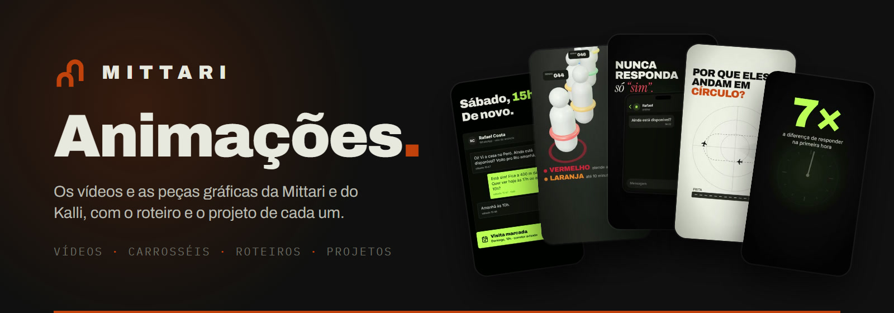
</p>

<p align="center">
  <a href="#leva-01-em-aprovação">Leva 01</a> ·
  <a href="#vídeos">Vídeos</a> ·
  <a href="#peças-gráficas">Peças gráficas</a> ·
  <a href="#conteúdo">Conteúdo</a> ·
  <a href="#como-está-organizado">Como está organizado</a> ·
  <a href="#vídeo-novo">Vídeo novo</a>
</p>

Todos os vídeos animados e as peças gráficas da Mittari: o arquivo pronto, o roteiro e o projeto de cada um. Clique numa capa para abrir a pasta do vídeo.

**Situação:** 🟢 pronto · 🟡 em aprovação · ⚪ só o projeto, sem o vídeo final · 🚧 pela metade

---

## Leva 02 (roteiros, para montar)

Roteiros da S10 e **a correção do gancho** (som no quadro 1, trilha do ElevenLabs Music, nada parado mais de 2 s) em [`conteudo/05 Ideias/Leva 02 — Roteiros para a S10 (09-11).md`](conteudo/05%20Ideias/). Começa reabrindo O01, T02 e U09 com o começo novo; depois T03, O02 e U10.

---

## Leva 01 (em aprovação)

Feita em 26/10/2026 no PC remoto, a partir dos roteiros de [`conteudo/05 Ideias`](conteudo/05%20Ideias/). Os vídeos estão juntos em [`videos/2026-10-26_leva-01_pc-remoto/`](videos/2026-10-26_leva-01_pc-remoto/).

<table>
  <tr>
    <td align="center" width="20%"><a href="videos/2026-10-26_leva-01_pc-remoto/2026-10-26_kalli_nunca-responda-so-sim/">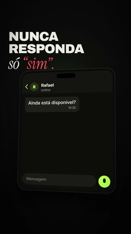</a><br><b>Nunca responda só "sim"</b><br><sub>T02 · 33 s · 🟡</sub></td>
    <td align="center" width="20%"><a href="videos/2026-10-26_leva-01_pc-remoto/2026-10-26_kalli_voce-nao-precisa-de-mais-clientes/"></a><br><b>Você não precisa de mais clientes</b><br><sub>O01 · 28 s · 🟡</sub></td>
    <td align="center" width="20%"><a href="videos/2026-10-26_leva-01_pc-remoto/2026-10-26_kalli_4-perguntas/"></a><br><b>As 4 perguntas</b><br><sub>T01 · 39 s · 🟡</sub></td>
    <td align="center" width="20%"><a href="videos/2026-10-26_leva-01_pc-remoto/2026-10-26_kalli_primeira-hora/">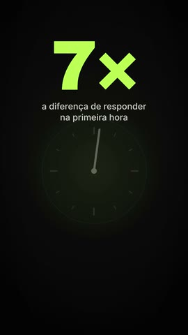</a><br><b>A conta da primeira hora</b><br><sub>E02 · 42 s · 🟡</sub></td>
    <td align="center" width="20%"><a href="videos/2026-10-26_leva-01_pc-remoto/2026-10-26_kalli_torre-de-controle/">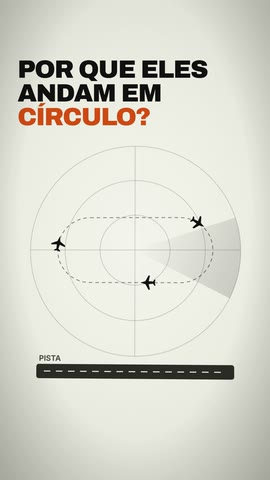</a><br><b>A torre de controle</b><br><sub>U09 · 47 s · 🟡</sub></td>
  </tr>
</table>

**O que falta da leva:** a R03 e a R04 dependem da gravação de tela real do app. A [H5, "Parece que você tem uma equipe"](videos/2026-10-26_leva-01_pc-remoto/2026-10-26_kalli_parece-uma-equipe/) 🚧 parou quando os créditos do ElevenLabs acabaram; a narração e as ilustrações da fachada já estão lá.

---

## Vídeos

### Kalli, vertical (9:16)

<table>
  <tr>
    <td align="center" width="25%"><a href="videos/2026-10-02_kalli_cliente-do-feriado/">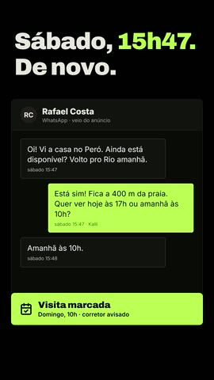</a><br><b>O cliente do feriado</b><br><sub>02/10 · 36 s · 🟢</sub></td>
    <td align="center" width="25%"><a href="videos/2026-10-05_kalli_vaca-do-feriado/">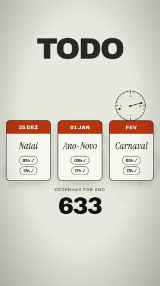</a><br><b>A vaca do feriado</b><br><sub>05/10 · 41,6 s · 🟢</sub></td>
    <td align="center" width="25%"><a href="videos/2026-10-06_kalli_pit-stop/">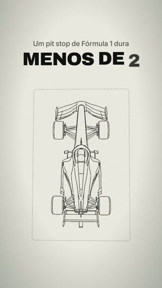</a><br><b>Pit stop</b><br><sub>06/10 · 47 s · 🟢</sub></td>
    <td align="center" width="25%"><a href="videos/2026-10-08_kalli_triagem/">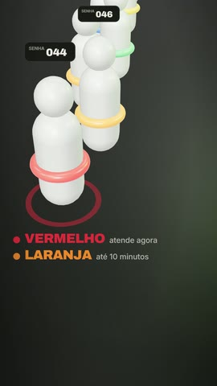</a><br><b>Triagem</b><br><sub>08/10 · 49,6 s · 🟢</sub></td>
  </tr>
</table>

### Horizontal (16:9)

<table>
  <tr>
    <td align="center" width="33%"><a href="videos/2026-10-07_kalli_curioso-e-comprador-3d/"></a><br><b>Curioso e comprador, filme 3D</b><br><sub>Kalli · 07/10 · 50 a 65 s · 🟢 sem a trilha final</sub></td>
    <td align="center" width="33%"><a href="videos/2026-10-07_kalli_curioso-e-comprador/"></a><br><b>Curioso e comprador</b><br><sub>Kalli · 07/10 · 24 s · 🟢 primeira versão</sub></td>
    <td align="center" width="33%"><a href="videos/2026-09-30_imobiflow_cliente-das-23h/">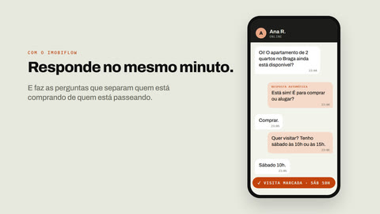</a><br><b>O cliente das 23h</b><br><sub>ImobiFlow · 30/09 · 21,6 s · 🟢</sub></td>
  </tr>
  <tr>
    <td align="center"><a href="videos/2026-09-30_imobiflow_em-30-segundos/"></a><br><b>ImobiFlow em 30 segundos</b><br><sub>ImobiFlow · 30/09 · 30 s · 🟢</sub></td>
    <td align="center"><a href="videos/2026-09-30_imobiflow_como-funciona-por-dentro/"></a><br><b>Como o ImobiFlow funciona por dentro</b><br><sub>ImobiFlow · 30/09 · 72,5 s · 🟢 teste, uso interno</sub></td>
    <td></td>
  </tr>
</table>

### Só o projeto (o vídeo final não está aqui)

<table>
  <tr>
    <td align="center" width="33%"><a href="videos/2026-10-02_kalli_numero-bloqueado/">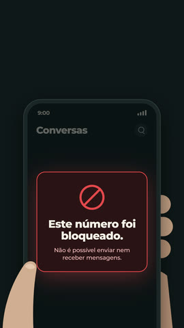</a><br><b>Número bloqueado</b><br><sub>Kalli · 02/10 · 30 s · ⚪</sub></td>
    <td align="center" width="33%"><a href="videos/2026-10-04_kalli_numero-que-caiu/">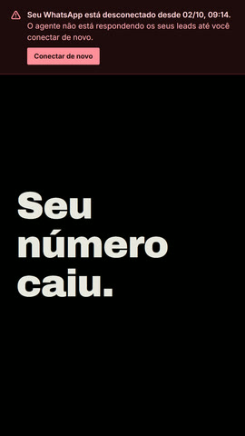</a><br><b>O número que caiu</b><br><sub>Kalli · 04/10 · 22 s e 32,6 s · ⚪</sub></td>
    <td align="center" width="33%"><a href="videos/2026-10-05_imobiflow_filme-3d/">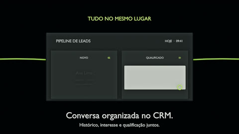</a><br><b>Filme 3D do ImobiFlow</b><br><sub>ImobiFlow · 05/10 · 12 s · ⚪</sub></td>
  </tr>
</table>

O ImobiFlow passou a se chamar **Kalli** em 02/10/2026. Os vídeos anteriores ainda mostram o nome antigo.

<details>
<summary><b>Lista completa em tabela</b></summary>

| Data | Vídeo | Produto | Duração | Formato | Situação |
|---|---|---|---|---|---|
| 30/09/2026 | [ImobiFlow em 30 segundos](videos/2026-09-30_imobiflow_em-30-segundos/) | ImobiFlow | 30 s | 16:9 | 🟢 Pronto |
| 30/09/2026 | [Como o ImobiFlow funciona por dentro](videos/2026-09-30_imobiflow_como-funciona-por-dentro/) (teste, uso interno) | ImobiFlow | 72,5 s | 16:9 | 🟢 Pronto |
| 30/09/2026 | [O cliente das 23h](videos/2026-09-30_imobiflow_cliente-das-23h/) | ImobiFlow | 21,6 s | 16:9 | 🟢 Pronto |
| 02/10/2026 | [O cliente do feriado](videos/2026-10-02_kalli_cliente-do-feriado/) | Kalli | 36 s | 9:16 | 🟢 Pronto |
| 02/10/2026 | [Número bloqueado](videos/2026-10-02_kalli_numero-bloqueado/) | Kalli | 30 s | 9:16 | ⚪ Só o projeto |
| 04/10/2026 | [O número que caiu](videos/2026-10-04_kalli_numero-que-caiu/) | Kalli | 22 s e 32,6 s | 9:16 | ⚪ Só o projeto |
| 05/10/2026 | [Filme 3D do ImobiFlow](videos/2026-10-05_imobiflow_filme-3d/) | ImobiFlow | 12 s | 16:9 e 9:16 | ⚪ Só o projeto |
| 05/10/2026 | [A vaca do feriado](videos/2026-10-05_kalli_vaca-do-feriado/) | Kalli | 41,6 s | 9:16 | 🟢 Pronto |
| 06/10/2026 | [Pit stop](videos/2026-10-06_kalli_pit-stop/) | Kalli | 47 s | 9:16 | 🟢 Pronto |
| 07/10/2026 | [Curioso e comprador](videos/2026-10-07_kalli_curioso-e-comprador/) (primeira versão) | Kalli | 24 s | 16:9 | 🟢 Pronto |
| 07/10/2026 | [Curioso e comprador, filme 3D](videos/2026-10-07_kalli_curioso-e-comprador-3d/) | Kalli | 50 a 65 s | 16:9 e 9:16 | 🟢 Pronto, sem a trilha final |
| 08/10/2026 | [Triagem](videos/2026-10-08_kalli_triagem/) | Kalli | 49,6 s | 9:16 | 🟢 Pronto |
| 26/10/2026 | [Nunca responda só "sim"](videos/2026-10-26_leva-01_pc-remoto/2026-10-26_kalli_nunca-responda-so-sim/) (T02) | Kalli | 33 s | 9:16 | 🟡 Em aprovação |
| 26/10/2026 | [Você não precisa de mais clientes](videos/2026-10-26_leva-01_pc-remoto/2026-10-26_kalli_voce-nao-precisa-de-mais-clientes/) (O01) | Kalli | 28,4 s | 9:16 | 🟡 Em aprovação |
| 26/10/2026 | [As 4 perguntas](videos/2026-10-26_leva-01_pc-remoto/2026-10-26_kalli_4-perguntas/) (T01) | Kalli | 39 s | 9:16 | 🟡 Em aprovação |
| 26/10/2026 | [A conta da primeira hora](videos/2026-10-26_leva-01_pc-remoto/2026-10-26_kalli_primeira-hora/) (E02) | Kalli | 42 s | 9:16 | 🟡 Em aprovação |
| 26/10/2026 | [A torre de controle](videos/2026-10-26_leva-01_pc-remoto/2026-10-26_kalli_torre-de-controle/) (U09) | Kalli | 47 s | 9:16 | 🟡 Em aprovação |
| 26/10/2026 | [Parece que você tem uma equipe](videos/2026-10-26_leva-01_pc-remoto/2026-10-26_kalli_parece-uma-equipe/) (H5) | Kalli | — | 9:16 | 🚧 Pela metade |

</details>

---

## Peças gráficas

<table>
  <tr>
    <td align="center" width="20%"><a href="pecas/2026-10-08_kalli_carrossel-5-sinais/">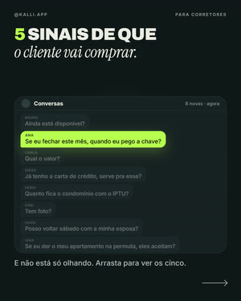</a><br><b>Carrossel "5 sinais"</b><br><sub>08/10 · 9 telas · 🟢</sub></td>
    <td align="center" width="20%"><a href="pecas/2026-10-06_kalli_carrossel-a-chave/trabalho/"></a><br><b>Carrossel "A chave"</b><br><sub>06/10 · 9 telas · ⚪</sub></td>
    <td align="center" width="20%"><a href="pecas/2026-10-05_kalli_capas-dos-destaques/trabalho/">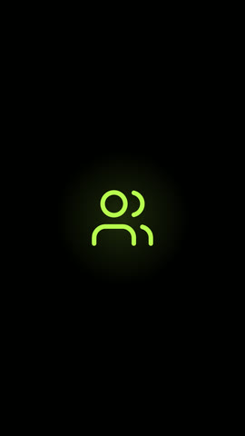</a><br><b>Capas dos destaques</b><br><sub>05/10 · 9:16 · ⚪</sub></td>
    <td align="center" width="20%"><a href="pecas/2026-10-02_kalli_foto-de-perfil/trabalho/"></a><br><b>Foto de perfil</b><br><sub>02/10 · 1:1 · ⚪</sub></td>
    <td align="center" width="20%"><a href="pecas/2026-10-04_kalli_imagem-de-compartilhamento/trabalho/">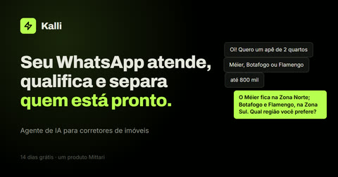</a><br><b>Imagem de compartilhamento</b><br><sub>04/10 · 1200×630 · ⚪</sub></td>
  </tr>
</table>

Detalhes de cada peça em [`pecas/`](pecas/).

---

## Conteúdo

A pasta [`conteudo/`](conteudo/) é uma cópia da pasta `18 Conteúdo` da Central da Mittari. **A fonte é a Central.** Leia aqui antes de produzir uma peça nova e registre o resultado na Central.

| Onde | O que tem |
|---|---|
| [`Hub de Conteúdo`](conteudo/Hub%20de%20Conte%C3%BAdo.md) | A porta de entrada da pasta |
| [`Painel de Saúde do Conteúdo`](conteudo/Painel%20de%20Sa%C3%BAde%20do%20Conte%C3%BAdo.md) | Como o conteúdo está indo |
| [`00 Manual`](conteudo/00%20Manual/) | Siglas, convenções e o jeito de produzir |
| [`01 Roteiros`](conteudo/01%20Roteiros/) | Roteiros aprovados |
| [`02 Animações`](conteudo/02%20Anima%C3%A7%C3%B5es/) | A ficha de cada animação |
| [`03 Peças Estáticas`](conteudo/03%20Pe%C3%A7as%20Est%C3%A1ticas/) | A ficha de cada peça |
| [`04 Publicações`](conteudo/04%20Publica%C3%A7%C3%B5es/) | O registro do que foi postado |
| [`05 Ideias`](conteudo/05%20Ideias/) | Roteiros e levas esperando produção |

---

## Como está organizado

```
videos/
  AAAA-MM-DD_produto_nome-do-video/
    README.md        ficha do vídeo: para quem, ideia, roteiro, cores, som
    final/           o que se usa: vídeo, capa e texto para postar
    planejamento/    plano e roteiro aprovados antes de animar (quando existem)
    trabalho/        o projeto, para refazer ou ajustar o vídeo
  AAAA-MM-DD_leva-NN_onde/
                     vídeos feitos juntos numa leva, com um README da leva
pecas/               imagens e carrosséis, no mesmo padrão
conteudo/            cópia da pasta 18 Conteúdo da Central
ferramentas/
  remotion/          estúdio Remotion compartilhado pelas animações de setembro
modelos/
  ficha-de-video.md  modelo da ficha para cada vídeo novo
.github/
  banner.jpg         a imagem do topo desta página
  galeria/           as capas pequenas que aparecem nesta página
```

A pasta `trabalho/` guarda o projeto como ele foi feito, com os nomes originais dos arquivos, para que continue funcionando.

### Regras de nome

- **Pasta:** data, produto e nome curto, tudo em minúsculas, sem acento, com hífen entre palavras e sublinhado entre as partes. Exemplo: `2026-10-08_kalli_triagem`.
- **Arquivos finais:** `produto_nome-do-video.mp4`, `produto_nome-do-video_capa.jpg` e `legenda-para-postar.txt`.
- **Variações** vão no fim do nome: `_60fps`, `_whatsapp-leve`, `_9x16`, `_v2`.
- **Versões novas:** o Git guarda o histórico. Para trocar um vídeo, substitua o arquivo e registre a mudança na ficha.

---

## Vídeo novo

1. Crie a pasta em `videos/` seguindo a regra de nome. Se o vídeo for de uma leva, crie a pasta dentro da pasta da leva.
2. Copie [`modelos/ficha-de-video.md`](modelos/ficha-de-video.md) para dentro dela como `README.md` e preencha.
3. Coloque os arquivos em `final/`, `planejamento/` e `trabalho/`.
4. Salve uma capa pequena em `.github/galeria/` (270×480 se for vertical, 480×270 se for horizontal) e acrescente o vídeo na galeria e na tabela desta página.

<details>
<summary><b>Arquivos grandes (Git LFS)</b></summary>

Vídeos, áudios em WAV e cenas do Blender (`.mp4`, `.mov`, `.wav`, `.blend`) ficam no **Git LFS**, o espaço do GitHub para arquivos grandes. Para baixar tudo, instale o Git LFS antes de clonar (`git lfs install`). Sem ele, esses arquivos chegam como textos curtos no lugar do vídeo.

</details>

## Regras de marca

- **Vídeo da Mittari:** laranja `#C2410C`, off-white `#E8E8E0` e preto `#101010`. Nunca verde-limão.
- **Vídeo do Kalli:** cores do próprio app (preto, verde-lima e laranja), não as da Mittari.
- **Vídeo para cliente:** uma história com o contexto real do cliente, não uma lista de funções.
- Sem robô, cérebro, engrenagem ou circuito. Sem termo técnico na tela.

O passo a passo completo está na Central da Mittari, em `13 Animações`.
