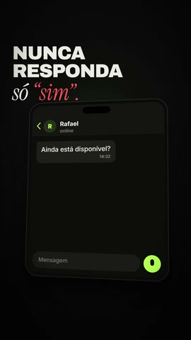
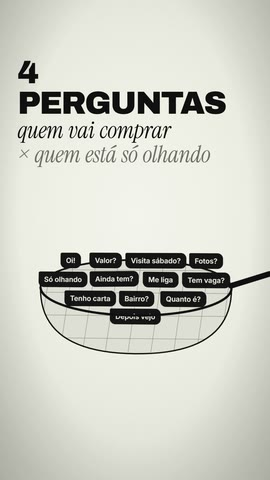
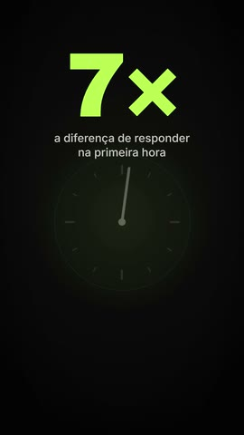
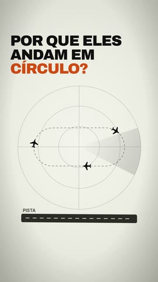

# Leva 01, feita no PC remoto (26/10/2026)

Vídeos da Leva 01 (roteiros em `conteudo/05 Ideias`) produzidos pelo Claude no PC remoto, na ordem da tabela da leva. Voz, trilha, efeitos sonoros e imagens foram gerados no ElevenLabs. A animação foi feita em HyperFrames.

Todos estão **em aprovação**. Nenhum foi postado.

<table>
  <tr>
    <td align="center" width="20%"> <b>T02</b></td>
    <td align="center" width="20%"> <b>O01</b></td>
    <td align="center" width="20%"> <b>T01</b></td>
    <td align="center" width="20%"> <b>E02</b></td>
    <td align="center" width="20%"> <b>U09</b></td>
  </tr>
</table>

| Roteiro | Vídeo | Duração | Situação |
|---|---|---|---|
| T02 | [Nunca responda só "sim"](2026-10-26_kalli_nunca-responda-so-sim/) | 33 s | Pronto |
| O01 | [Você não precisa de mais clientes](2026-10-26_kalli_voce-nao-precisa-de-mais-clientes/) | 28,4 s | Pronto |
| T01 | [As 4 perguntas](2026-10-26_kalli_4-perguntas/) | 39 s | Pronto |
| E02 | [A conta da primeira hora](2026-10-26_kalli_primeira-hora/) | 42 s | Pronto, com o roteiro corrigido (ver a ficha) |
| R03 | — | — | Falta a gravação de tela real do app |
| R04 | — | — | Falta a gravação de tela real do app |
| U09 | [A torre de controle](2026-10-26_kalli_torre-de-controle/) | 47 s | Pronto |
| H5 | [Parece que você tem uma equipe](2026-10-26_kalli_parece-uma-equipe/) | — | Pela metade: os créditos do ElevenLabs acabaram |

## Em cada pasta

- `final/`: o vídeo em 60 fps para postar, a capa e a legenda. T01 e U09 têm também uma versão leve para mandar pelo WhatsApp.
- `trabalho/`: o projeto HyperFrames (`index.html`), a narração, a trilha e os efeitos. Para renderizar de novo: `npx --yes hyperframes@0.8.206 render` dentro da pasta.
- `README.md`: a ficha do vídeo.

## O que falta

- **R03 e R04:** gravar a tela do app com um número de teste e um segundo celular, como descrito no documento da Leva 01.
- **H5:** já tem a narração e três ilustrações da fachada. Faltam a trilha, as cenas do corretor (na visita e no carro) e a transcrição para sincronizar a letra.
- **Central:** mover os roteiros produzidos de `05 Ideias` para `01 Roteiros` e criar a ficha de cada um em `02 Animações`.
- A trilha da U09 não passou pela conferência de voz cantada.
